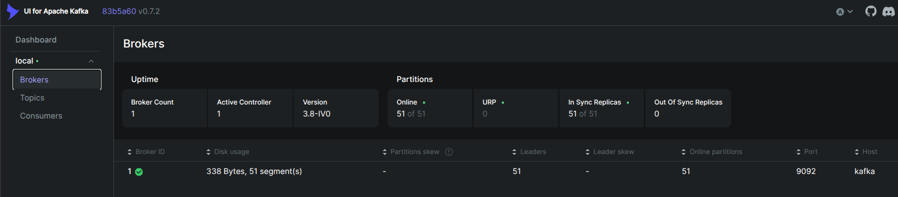

# Todo List
 
A simple to-do list built with Angular (frontend), Express (backend) and MongoDB (database). Every change to a task (created, completed, deleted) is also sent to Apache Kafka as an event.
 
## Project Structure
 
```
todolist/
├── docker-compose.yml      # MongoDB, Kafka, Kafka UI, backend, frontend
├── backend/
│   ├── Dockerfile
│   ├── package.json
│   └── src/
│       ├── index.ts        # Express server, startup
│       ├── db.ts           # MongoDB collection setup
│       ├── todos.ts        # Routes for tasks
│       └── kafka.ts        # Kafka producer and consumer
└── frontend/
    ├── Dockerfile
    ├── nginx.conf          # Serves Angular, forwards /api to the backend
    ├── proxy.conf.json     # Dev proxy: /api -> localhost:3000
    └── src/
        ├── main.ts         # Angular bootstrap
        └── app/
            ├── app.ts            # Component
            ├── app.html          # Template
            ├── app.css           # Styles
            └── todo.service.ts   # Requests to the backend
```
 
## Installation
 
Requires Docker.
 
```bash
docker compose up -d --build
```
 
| Service | URL |
|---|---|
| Frontend (todo app) | http://localhost:8080 |
| Backend | http://localhost:3000/api/health |
| Kafka UI | http://localhost:8090 |
| MongoDB | `mongodb://localhost:27017/todoapp` |
| Kafka | `localhost:29092` |
 
Stop: `docker compose down` (add `-v` to also delete the data)
 
## Kafka
 
The backend sends an event to the Kafka topic `todos` whenever a task is created, changed or deleted. The backend also reads the same topic (consumer group `todolist-logger`) and prints the events to its log (`docker compose logs -f backend`).
 
There is one topic, `todos`, with one partition. The messages can be viewed in Kafka UI: **Topics → todos → Messages**.

